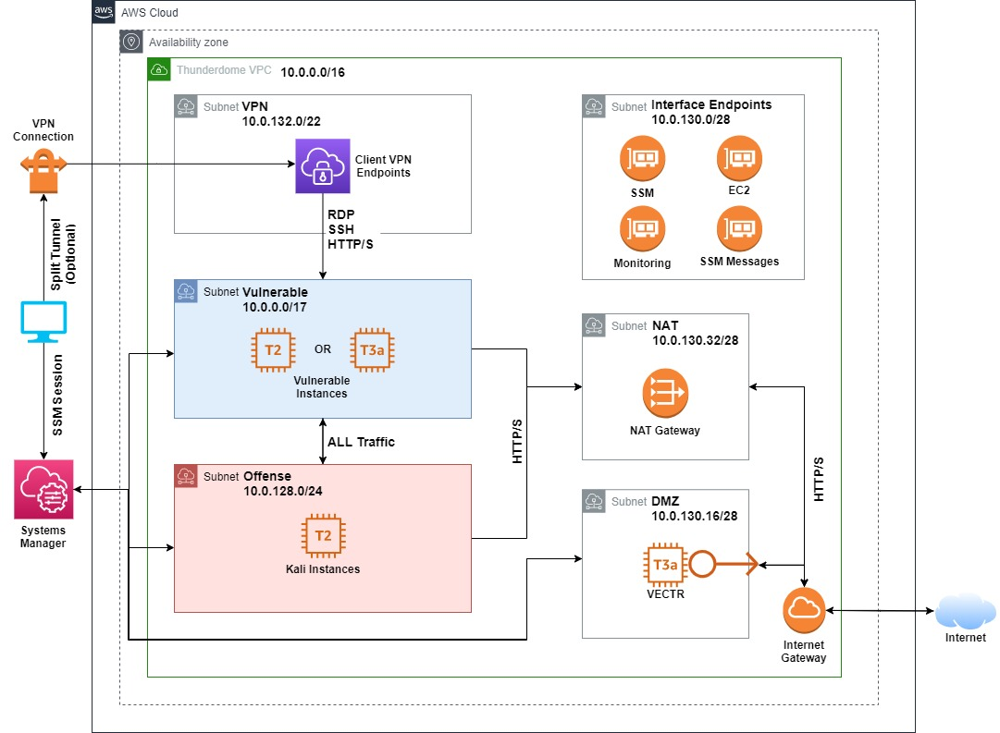

# Thunderdome Cyber Range

Thunderdome creates a single-Availability-Zone AWS cyber range with private Kali and VECTR hosts. Operators reach VECTR through AWS Client VPN and reach the hosts through AWS Systems Manager. The EC2 instances do not receive public IP addresses; a public NAT gateway provides outbound access for first-boot installation and updates.

The repository uses the current official Kali AWS Marketplace image and Canonical Ubuntu 22.04 for VECTR. It does not build custom AMIs. Automated tests validate the Terraform and bootstrap logic locally, but a successful local test does not prove that a particular AWS account has the required permissions, service quotas, Marketplace entitlement, or network capacity. Review the saved Terraform plan before applying it.



## Prerequisites

You need:

- A Linux workstation with Bash and administrative access for package installation.
- AWS CLI credentials for the target account. Short-term credentials from `aws login`, IAM Identity Center, or another supported credential process are preferred.
- Permission to inspect and accept the pinned Kali Marketplace offer, import an ACM certificate, and manage the AWS resources in `infra/`.
- OpenVPN or another AWS Client VPN-compatible client.
- The [Session Manager plugin](https://docs.aws.amazon.com/systems-manager/latest/userguide/session-manager-working-with-install-plugin.html) for interactive host verification.

The setup script installs Terraform 1.10 or newer, terraform-docs 0.24.0, `jq`, and the required operating-system packages. It also initializes the Terraform root module.

```bash
git clone <repository-url> thunderdome
cd thunderdome
scripts/setup.sh
```

Authenticate, then verify the account before continuing:

```bash
export THUNDERDOME_ACCOUNT_ID=123456789012
export AWS_REGION=us-east-1
aws sts get-caller-identity
```

Every AWS-mutating helper requires the expected 12-digit account ID and refuses to continue when the authenticated account differs. Add `--profile PROFILE_NAME` to the helper commands if you do not use the default AWS credential chain.

## Cost-bearing resources

This stack incurs AWS charges while it exists. Review the current regional pricing before applying it. The main cost-bearing resources are:

- A public NAT gateway, its Elastic IP address, processed data, and data transfer.
- An AWS Client VPN endpoint association, active client connections, public IPv4 addresses used by the service, and CloudWatch connection logs.
- Kali and VECTR EC2 instances and their encrypted gp3 volumes.
- A Route 53 private hosted zone.
- Three optional Systems Manager interface endpoints when `enable_ssm_endpoints = true`.

The Kali Marketplace software offer is pinned to the official free offer, but the EC2 instance, storage, networking, and related AWS services are billed separately. See [AWS Client VPN pricing](https://aws.amazon.com/vpn/pricing/), [Amazon VPC pricing](https://aws.amazon.com/vpc/pricing/), [Amazon EC2 pricing](https://aws.amazon.com/ec2/pricing/), and [Amazon CloudWatch pricing](https://aws.amazon.com/cloudwatch/pricing/).

## Configure feature flags

Defaults create one Kali instance, private VECTR, Client VPN with connection logging, and no paid Systems Manager interface endpoints. To override them, create `infra/local.auto.tfvars`; this filename is ignored by Git.

```hcl
enable_vpn           = true
vpn_logging_enabled = true
enable_vectr         = true
kali_count           = 1
enable_ssm_endpoints = false
```

`enable_vectr = true` requires `enable_vpn = true` because VECTR has no public access path. A zero `kali_count` omits Kali. Disabling `enable_ssm_endpoints` removes only the three paid interface endpoints; the instances retain Systems Manager agents and IAM profiles and can register through the NAT gateway.

The default region and Availability Zone are `us-east-1` and `us-east-1a`. If you change `AWS_REGION`, set matching `vpc_region` and `vpc_availability_zone` values in the same tfvars file before preparing certificates or planning.

The remaining network, release, tagging, and feature inputs are documented in [infra/README.md](infra/README.md).

## Review and accept the Kali offer

The default command is read-only. It verifies the fixed listing, product, publisher, AMI fulfillment method, free software price, legal term, and support term, then reports any active agreement.

```bash
scripts/accept_kali_marketplace.sh \
  --account-id "$THUNDERDOME_ACCOUNT_ID"
```

Acceptance is a separate, binding action. Re-run with `--accept`, review the generated quote, and type the exact confirmation requested by the script:

```bash
scripts/accept_kali_marketplace.sh \
  --account-id "$THUNDERDOME_ACCOUNT_ID" \
  --accept
```

Use `--yes` only in an automation context where a human has already approved that exact account and quote. The helper refuses changed product identifiers, publishers, terms, fulfillment methods, expiration, or nonzero Marketplace software charges. The official listing is [Kali Linux on AWS Marketplace](https://aws.amazon.com/marketplace/pp/prodview-fznsw3f7mq7to).

## Prepare Client VPN certificates

Generate the private certificate authority, server certificate, and client certificate before planning the VPN. The helper imports only the server certificate and key into ACM. Private material remains under the Git-ignored `.vpn-info/` directory.

```bash
scripts/prepare_vpn.sh \
  --account-id "$THUNDERDOME_ACCOUNT_ID" \
  --region "$AWS_REGION"
```

Existing usable certificate material is preserved. Pass `--rotate` only when you intend to replace it; rotation can require replacing the Client VPN endpoint.

## Plan and apply

Run Terraform through the account-guarding wrapper. It exports short-term credentials only to the Terraform child process and sets the required `expected_aws_account_id` input.

```bash
scripts/terraform.sh --account-id "$THUNDERDOME_ACCOUNT_ID" -- \
  -chdir=infra init

scripts/terraform.sh --account-id "$THUNDERDOME_ACCOUNT_ID" -- \
  -chdir=infra plan -out=thunderdome.tfplan
```

Before applying, inspect the plan for:

- The expected account and region.
- No public IP addresses on Kali or VECTR.
- One NAT gateway and only the intended public Elastic IP address.
- The intended EC2 instance counts and types, encrypted EBS volumes, IAM attachments, security groups, network ACLs, and Client VPN authorization.
- Zero Systems Manager endpoints unless `enable_ssm_endpoints` was explicitly enabled.
- No unexplained replacement or destruction.

Apply the reviewed saved plan:

```bash
scripts/terraform.sh --account-id "$THUNDERDOME_ACCOUNT_ID" -- \
  -chdir=infra apply thunderdome.tfplan
```

Terraform keeps state locally in `infra/terraform.tfstate`. The state is Git-ignored but can still contain sensitive infrastructure metadata. Store it securely, do not run concurrent Terraform operations, and back it up before changing or destroying the stack. This repository does not configure remote state or state locking.

## Export and connect to Client VPN

After apply completes, export the AWS profile and embed the local client certificate and key:

```bash
scripts/export_vpn_config.sh \
  --account-id "$THUNDERDOME_ACCOUNT_ID" \
  --region "$AWS_REGION"
```

The generated `.vpn-info/config.ovpn` is written with mode `0600`. Treat it as a credential and do not share or commit it.

Connect with an OpenVPN-compatible client. On Linux:

```bash
sudo openvpn --config .vpn-info/config.ovpn
```

Confirm that the tunnel receives an address from `172.31.252.0/22`, then verify private DNS:

```bash
getent hosts thunderdome.lab
```

## Verify first-boot readiness

Kali and VECTR install software after EC2 reports `running`. Package downloads and container image pulls can take several minutes. Do not treat instance state alone as application readiness.

List the generated Kali session commands:

```bash
terraform -chdir=infra output -json kali_ssm_session_commands
```

Start a session with one of those commands and verify the bootstrap marker:

```bash
sudo test -f /var/lib/thunderdome-bootstrap/kali-tools.ready
```

For the default VECTR name, locate its instance and start a Systems Manager session:

```bash
VECTR_INSTANCE_ID=$(aws ec2 describe-instances \
  --region "$AWS_REGION" \
  --filters 'Name=tag:Name,Values=thunderdome-vectr' 'Name=instance-state-name,Values=running' \
  --query 'Reservations[].Instances[].InstanceId' \
  --output text)
aws ssm start-session --region "$AWS_REGION" --target "$VECTR_INSTANCE_ID"
```

On VECTR, both commands must succeed before using the application:

```bash
sudo systemctl is-active vectr.service
sudo docker compose --project-directory /opt/vectr/runtime ps
```

While connected to Client VPN, open `https://thunderdome.lab:8081`. VECTR Community Edition generates an untrusted self-signed certificate by default, so a browser warning is expected. Verify that the hostname is `thunderdome.lab`; then follow the [VECTR SSL certificate guidance](https://docs.vectr.io/ssl/SSL_Certificates/) if you choose to import its generated CA. Do not disable certificate verification globally. Complete the VECTR first-login setup in the application.

## Destroy the range

An explicit full destroy deletes the VECTR data volume, even though that separate volume survives an ordinary VECTR instance replacement. Export any data you need before continuing.

Create and inspect a saved destroy plan:

```bash
scripts/terraform.sh --account-id "$THUNDERDOME_ACCOUNT_ID" -- \
  -chdir=infra plan -destroy -out=destroy.tfplan

scripts/terraform.sh --account-id "$THUNDERDOME_ACCOUNT_ID" -- \
  -chdir=infra apply destroy.tfplan
```

The ACM server certificate imported by `prepare_vpn.sh` and the local `.vpn-info/` credentials are outside Terraform state and remain after destroy. Keep them if you will redeploy. Delete them separately only after confirming that no remaining Client VPN endpoint or user needs them.

## Development and generated documentation

Run the complete local checks from the repository root. Module-specific commands are listed in `AGENTS.md` and the implementation plan under `docs/superpowers/`.

Regenerate Terraform input and output tables after changing module interfaces:

```bash
scripts/gen_terraform_docs.sh
```

The generator uses the terraform-docs version installed by `scripts/setup.sh` and atomically replaces the root and module README files.

## Acknowledgements

- [VECTR Community Edition](https://github.com/SecurityRiskAdvisors/VECTR)
- [Kali Linux](https://www.kali.org/)
- [Terraform](https://developer.hashicorp.com/terraform)
- [terraform-docs](https://terraform-docs.io/)
- [EasyRSA](https://github.com/OpenVPN/easy-rsa)

## License

[MIT License](./LICENSE.txt)

Copyright (c) 2020 Michael Ibeh
